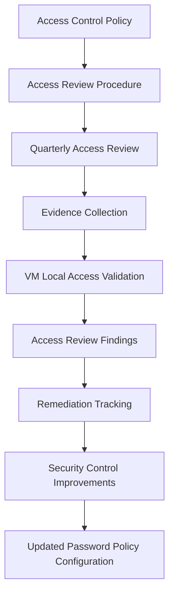

# IAM Access Review Lab

> Part of the Burn and Churn Coffee security program: [program hub](https://github.com/MgnCoding2020/grc-paper-project-coffee-shop). Company, people, systems and vendors are defined there.

## Purpose

This repository will demonstrate a simulated **quarterly access review process** for a small-business environment.

The goal of this lab is to show how Identity and Access Management (IAM) governance activities are performed, documented, and tracked by a security or GRC analyst.

## Organization Scenario

This lab uses a fictional company:

**Burn and Churn Coffee**

Company size:

* 1 Business Owner
* 1 Store Manager
* 3 Shift Leaders
* 15 Baristas (20 active store staff in total)
* 2 IT vendors: Vertex IT Support (active) and NorthPeak Systems (engagement ended)

Systems reviewed during access certification include:

* Google Workspace
* Toast POS
* xtraCHEF inventory platform
* QuickBooks Online
* Store networking infrastructure

## Repository Contents

This repository demonstrates the operational side of IAM governance, including:

* Quarterly Access Review Procedure
* Access Review Evidence Collection
* Access Findings Documentation
* Remediation Tracking
* Access Review Summary

## IAM Governance Workflow

## Goal

This project demonstrates how a junior GRC or security analyst may perform and document an **access certification review** to validate:

* Least privilege access
* Removal of inactive accounts
* Proper assignment of administrative privileges
* Access alignment with job roles

## Current Repository Artifacts

This repository currently includes:

- Quarterly Access Review Procedure
- Access Review Evidence
- Access Review Findings
- Remediation Tracker
- Quarterly Review Summary

## Project Focus

This lab demonstrates how a junior GRC, IAM, or security analyst may document and execute a quarterly access certification review for a small business environment.
