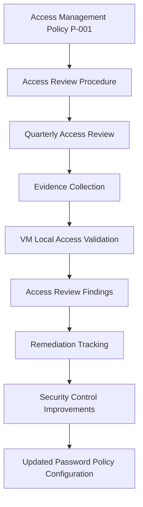

# IAM Access Review Lab

> Part of the Burn and Churn Coffee security program: [program hub](https://github.com/MgnCoding2020/grc-paper-project-coffee-shop). Company, people, systems and vendors are defined there.

## Purpose

This repository demonstrates a simulated **quarterly access review process** for a small-business environment.

The goal of this lab is to show how Identity and Access Management (IAM) governance activities are performed, documented, and tracked by a security or GRC analyst.

## Organization Scenario

This lab uses a fictional company:

**Burn and Churn Coffee**

Company size:

* 1 Business Owner
* 1 Store Manager
* 3 Shift Leaders
* 15 Baristas (20 active store staff in total)
* A part-time in-house IT Technician (planned hire, replacing Vertex IT Support under the program's change CR-003)
* IT vendors at the Q1 review: Vertex IT Support (being offboarded) and NorthPeak Systems (engagement ended)

Systems in the **Q1 2026** review (Google Workspace era):

* Google Workspace
* Toast POS
* xtraCHEF inventory platform
* QuickBooks Online
* Store networking infrastructure

From the **Q4 2026** review: Microsoft Entra ID (after the Microsoft 365 cutover, CR-001), Toast POS, xtraCHEF, network administration, the password manager and connected-device vendor portals. See [reviews/2026-Q4/](reviews/2026-Q4/README.md).

## Repository Contents

Each review has its own folder, so earlier reviews stay exactly as recorded:

| Folder | Contents |
|---|---|
| [`procedure/`](procedure/quarterly-access-review-procedure.md) | The review procedure, used by every review |
| [`reviews/2026-Q1/`](reviews/2026-Q1/) | The Q1 2026 review (Google Workspace era): evidence, findings, remediation, summary. Moved here unchanged on 2026-11-02 |
| [`reviews/2026-Q4/`](reviews/2026-Q4/README.md) | The Q4 2026 review, the first in Microsoft Entra ID (planned, after 2026-11-15) |
| [`docs/`](docs/) | Supporting notes |

This repository demonstrates the operational side of IAM governance, including:

* Quarterly Access Review Procedure
* Access Review Evidence Collection
* Access Findings Documentation
* Remediation Tracking
* Access Review Summary

## IAM Governance Workflow

## Review History

| Review | Date | Systems | Findings | Status | Program linkage |
|---|---|---|---|---|---|
| Q1 2026 | 2026-03-25 | Google Workspace, Toast POS, xtraCHEF, QuickBooks Online, network admin | F-001 to F-004 (plus F-005, a lab demonstration) | F-001 to F-004 **overdue** at the 2026-10-30 [status check](reviews/2026-Q1/remediation/status-checks.md); closing through CR-001 and CR-003 | POAM-014 (AC-2, AC-6) |
| Q4 2026 | Planned, after 2026-11-15 | Microsoft Entra ID (including admin, break-glass and guest accounts), Toast POS, xtraCHEF, network admin, password manager, connected-device and vendor portals ([planned scope](procedure/quarterly-access-review-procedure.md#planned-additions-to-scope-first-review-after-2026-11-15)) | — | Planned: the first review against Entra ID, and the post-implementation review for CR-001 and CR-003 | — |

Corrections to dated records are logged in [reviews/2026-Q1/evidence/CORRECTIONS.md](reviews/2026-Q1/evidence/CORRECTIONS.md).

## Goal

This project demonstrates how a junior GRC or security analyst may perform and document an **access certification review** to validate:

* Least privilege access
* Removal of inactive accounts
* Proper assignment of administrative privileges
* Access alignment with job roles

## Current Repository Artifacts

This repository currently includes:

- Quarterly Access Review Procedure ([procedure/](procedure/quarterly-access-review-procedure.md))
- The Q1 2026 review: evidence, findings (including a lab demonstration, F-005), remediation tracker with status checks, and summary ([reviews/2026-Q1/](reviews/2026-Q1/))
- The Q4 2026 review plan ([reviews/2026-Q4/](reviews/2026-Q4/README.md))

## Project Focus

This lab demonstrates how a junior GRC, IAM, or security analyst may document and execute a quarterly access certification review for a small business environment.
